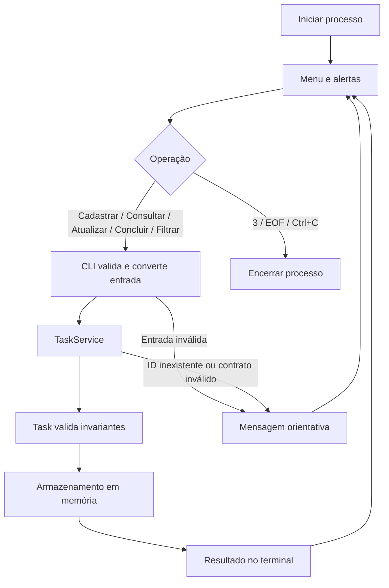

# TaskTracker - Entrega 3 / candidata a release

Gerenciador de tarefas em Python, com CLI, domínio isolado, testes automatizados e execução em Docker. O projeto evolui a Entrega 1 e reutiliza a base desenvolvida no Bootcamp II.

**Estado em 26/10/2026:** candidata `1.0.0rc1` preparada em `feature/entrega3-final`, ainda sem homologação humana e sem release estável. O [PR #16](https://github.com/gustavoaraujocd/tasktrackerr/pull/16) foi integrado em develop. O [PR #17](https://github.com/gustavoaraujocd/tasktrackerr/pull/17) permanece aberto para main, sem aprovação humana. A tag `v1.0.0` será criada somente após integração permitida pelas proteções e validação do commit final.

## Equipe

| Integrante | RA |
|---|---|
| Jonathan Rodrigues Silva Corrêa | 22450356 |
| Matheus Couto Nogueira | 22505474 |
| Esther Diniz Bastos | 22505492 |
| Cauã Gonçalves Xavier Mrad | 22452326 |
| Rillary Lorranne de Souza Portilho | 22450936 |
| Gustavo Araújo do Carmo | 22304113 |

ADS - Taguatinga / Noturno.

**Líder para submissão:** Gustavo Araújo do Carmo - RA 22304113.


## Instalação e execução

Python 3.11+ e Git. No Windows use `python`; Linux/macOS podem usar `python3`.

```bash
git clone https://github.com/gustavoaraujocd/tasktrackerr.git
cd tasktrackerr
git switch main
python -m venv .venv
```

Os comandos acima selecionam a branch de distribuição. Enquanto a integração da Entrega 3 estiver pendente, para avaliar esta candidata execute `git switch feature/entrega3-final` antes de instalar. O ZIP da Entrega 3 já contém a candidata e dispensa clone/switch. Não execute `git switch v1.0.0` antes da publicação real da tag.

Ative o ambiente:

- Windows PowerShell: `.venv\Scripts\Activate.ps1`
- Linux/macOS: `source .venv/bin/activate`

```bash
python -m pip install -e ".[dev]"
python src/main.py
```

## Menu e exemplo de uso

| Opção | Operação |
|---|---|
| 1 | Cadastrar tarefa |
| 2 | Listar todas |
| 3 | Sair |
| 4 | Consultar pelo ID completo |
| 5 | Atualizar |
| 6 | Concluir |
| 7 | Filtrar por status |

Cadastre uma tarefa pela opção 1 e copie o ID mostrado. Use o ID em 4, 5 ou 6; em 7, escolha `pendente`, `em_andamento` ou `concluida`.
Na atualização, Enter mantém o valor e `-` limpa descrição/data/hora. Para remover uma data com horário, remova ambos no mesmo formulário.
Datas: DD/MM/AAAA; hora: HH:MM. Sem data, não é solicitado horário.
Entradas inválidas e IDs inexistentes são informados sem encerrar o menu. EOF/Ctrl+C encerram de forma controlada.

## Ambiente Docker

Requer Docker Engine/Desktop iniciado e Compose v2.

```bash
docker compose config
docker compose run --build --rm tasktracker-app
```

Alternativa usando a imagem diretamente:

```bash
docker build -t tasktracker:phase3 .
docker run --rm -it tasktracker:phase3
```

O nome histórico da imagem é mantido para compatibilidade. A imagem runtime usa UID 10001, sem privilégios de root. O estágio de testes instala Pytest separadamente.
O Compose habilita stdin e TTY. Sem serviço web, portas ou bind mounts de código.

## Testes reproduzíveis

```bash
python -m pytest -q --cov --cov-report=term-missing --cov-report=xml --cov-report=html --junitxml=test-results.xml
docker compose run --build --rm -T tests
docker compose run --build --rm -T coverage
```

A execução local da Entrega 3 e as métricas exatas estão em [relatório E3](docs/relatorio-testes-e3.md), com JUnit, XML de coverage e log em `docs/evidencias/e3/`. Todos os testes coletados precisam passar. Passagem de 100% da suíte não significa cobertura de 100% ou ausência de defeitos. O limite automatizado de cobertura combinada (linhas e ramos) é 90%.
O workflow mantém os checks `test` e `docker` e publica JUnit, XML e HTML da cobertura. O serviço `coverage` grava resultados em `reports/` no host; o teste simples não exige volume.

- [Relatório de testes](docs/relatorio-testes-e2.md).
- [Falhas antes da correção](docs/evidencias/antes.log).
- [Execução posterior](docs/evidencias/depois.log) e [JUnit](docs/evidencias/depois.xml).
- [Ações do repositório](https://github.com/gustavoaraujocd/tasktrackerr/actions).

## Arquitetura e fluxo

- `src/main.py`: entrada, mensagens e orquestração.
- `models.py`: Task/Priority/Status e invariantes.
- `service.py`: cadastro, consulta, atualização, conclusão, filtro e atraso.
- `tests/`: domínio, regressões e integração da CLI.
- `docs/`: especificação, ADRs, análise de IA e evidências.



## Contratos e limites

Título obrigatório; prioridade e status controlados por enums; identidade e data de criação preservadas no update.
Prazos são civis locais, sem fuso; `created_at` é UTC-aware. `datetime` não é aceito como data; horário exige data; referência de atraso com timezone é rejeitada explicitamente.
Sem hora, o prazo termina no fim do dia; só há atraso após o instante definido. Concluídas não alertam; em andamento continuam sujeitas ao prazo.
A atualização valida todos os campos antes de substituir o registro.

Os dados são perdidos ao sair. Não há autenticação, sincronização, persistência, isolamento multiusuário ou prontidão para produção. Objetos retornados pelo serviço são mutáveis e devem ser tratados pelos casos de uso, sem alteração direta.
As tags Docker e dependências não estão integralmente fixadas por hash; reprodutibilidade funcional não significa build idêntico em todos os momentos.
O Codespaces é opcional, consome cota e não é requisito para execução; seu rebuild completo não foi homologado nesta etapa.

## Governança e documentação

Fluxo: `feature/* -> PR -> develop -> PR -> main`.
Antes de cada merge: CI aprovado no SHA atual, evidências conferidas, revisão humana independente e comentários resolvidos. O autor não substitui a aprovação de um colega.
A proteção de main e develop foi confirmada no [ruleset 25727805](https://github.com/gustavoaraujocd/tasktrackerr/rules/25727805): PR, uma aprovação independente, checks test/docker, base atualizada, resolução de conversas e aprovação do último push. Sem bypass; force push e exclusão bloqueados. As aprovações do PR #16 não aprovam o PR #17 ou a Entrega 3. Pedidos a Esther/Cauã falharam anteriormente por falta de colaboradores habilitados, conforme relato do responsável; não foram repetidos nem considerados aprovações.

Documentação atual: [SDD As-Built](docs/sdd-as-built.md), [testes e coverage](docs/relatorio-testes-e3.md), [retrospectiva](docs/retrospectiva-e3.md), [roteiro de vídeo](docs/roteiro-video-e3.md), [release e bloqueios](docs/release-e3.md). Os documentos E1/E2 abaixo são históricos e seus números não representam esta candidata. Vídeo final: não fornecido/não gravado nesta execução. Nenhum link fictício foi incluído.

- [PR #4: revisão histórica da Entrega 1](https://github.com/gustavoaraujocd/tasktrackerr/pull/4).
- [PR #6: integração histórica](https://github.com/gustavoaraujocd/tasktrackerr/pull/6).
- [PR #16: revisão desta entrega](https://github.com/gustavoaraujocd/tasktrackerr/pull/16).
- [Sprint 2: código e contratos #14](https://github.com/gustavoaraujocd/tasktrackerr/issues/14).
- [Sprint 2: relatório e documentação #15](https://github.com/gustavoaraujocd/tasktrackerr/issues/15).
- [Especificação SDD](docs/especificacao-sdd.md).
- [ADRs e trade-offs](docs/adrs.md).
- [Refinamento por testes](docs/refinamentos-e2.md).
- [Análise comparativa e ético-técnica](docs/analise-ia-e2.md).
- [Governança e relato de experiência](docs/governanca-e2.md).

Codex foi usado com apoio do ChatGPT. Claude Code, Cursor e Antigravity foram avaliados apenas pela documentação oficial. Não há benchmark comparativo executado nem resultado atribuído às ferramentas não utilizadas.

## PDF consolidado da Entrega 2

[Baixar relatório do Bootcamp III](docs/entrega2-bootcamp3.pdf) | [Versão textual](docs/entrega2-bootcamp3.md).
O PDF registra a revisão técnica validada e a pendência de homologação humana do PR #16.

## Conferência com a apostila da Entrega 2

A comparação documental não encerra o requisito de experimento com dados próprios. Consulte a [auditoria do guia](docs/auditoria-guia-e2.md) e o [protocolo comparativo](docs/experimento-ia.md).

- [Demonstração ponta a ponta](docs/DEMO.md).
- [Registro de erros](docs/ERROS.md).
- [Log integral do job Docker](logs_testes_final.txt).

A captura autêntica do harness foi concluída e está em [docs/evidencias/testes-github-actions.png](docs/evidencias/testes-github-actions.png), com comando e 39 testes aprovados. Permanecem as conferências e o fechamento da governança descritos na auditoria. O responsável retirou o experimento da lista; a comparação continua documental e o requisito empírico não foi atendido.
